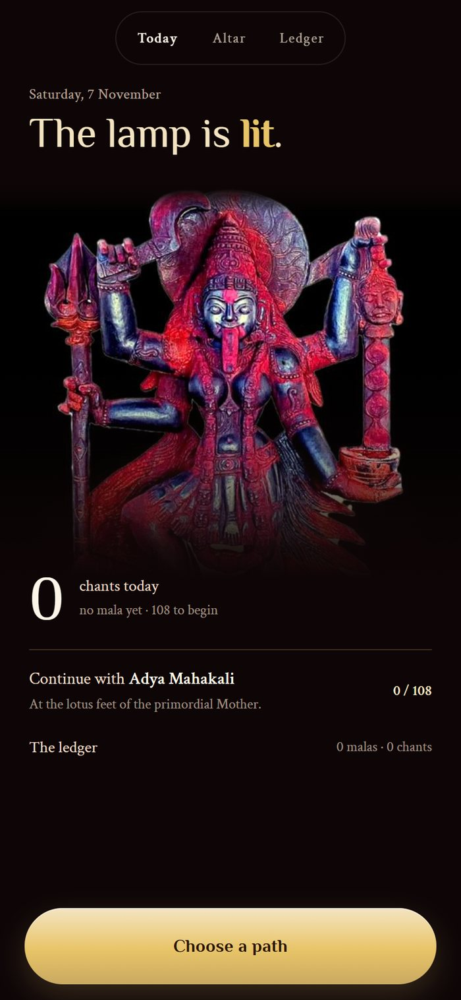
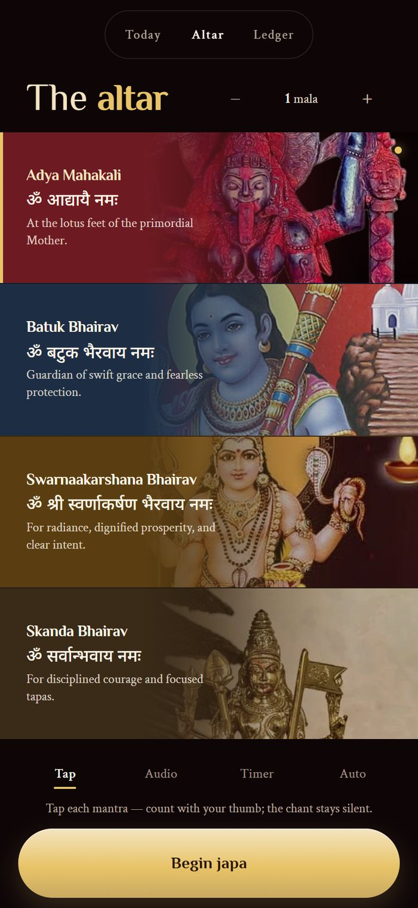
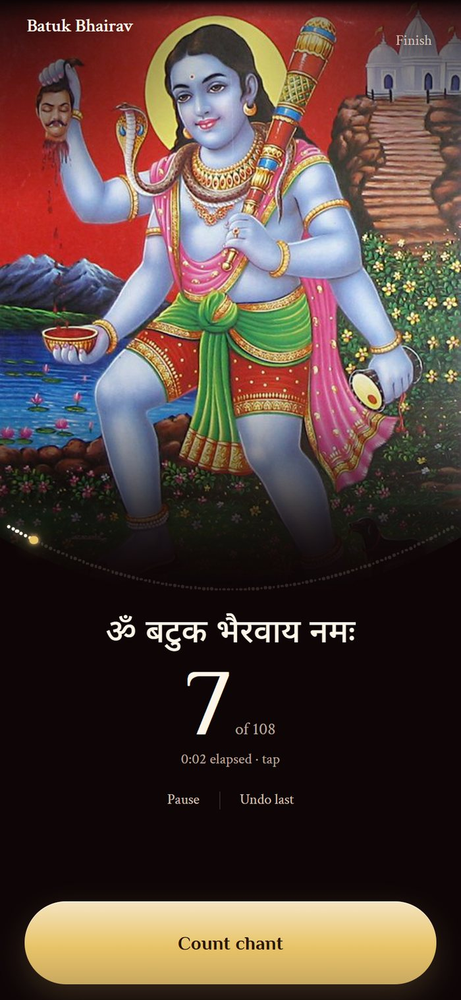
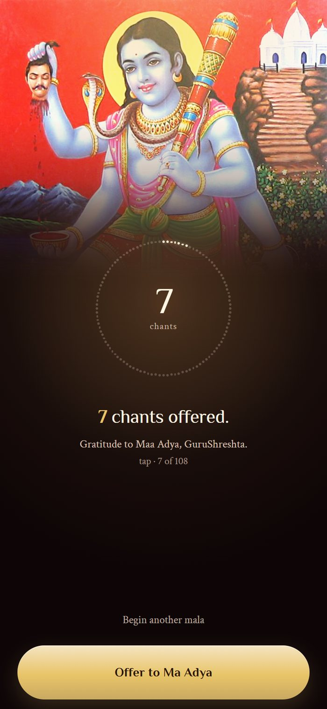
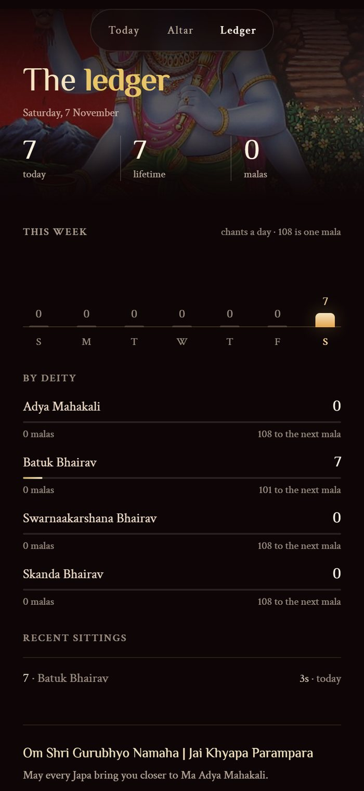

<p align="center">
  
</p>

<h1 align="center">MANTRINI</h1>

<p align="center">
  <strong>A respectful, offline japa counter for the Khyapa Parampara.</strong><br>
  Four altars · 108 beads · nothing that leaves the device.
</p>

<p align="center">
  <a href="https://mantrini.jaikhyapaparampara.com/"></a>
  <a href="https://github.com/09ashishkapoor/Project_Apex11/actions/workflows/cloudflare-pages.yml"></a>
  
  <a href="LICENSE"></a>
</p>

<p align="center">
  
  
  
  
  
</p>

<p align="center"><sub><strong>Today</strong> · <strong>Altar</strong> · <strong>Session</strong> · <strong>Blessing</strong> · <strong>Ledger</strong></sub></p>

<p align="center"><strong>Live:</strong> <a href="https://mantrini.jaikhyapaparampara.com/">mantrini.jaikhyapaparampara.com</a></p>

MANTRINI is a progressive web app: one codebase, installable from the browser on
Android and iPhone, and it keeps counting with the network completely cut after
the first visit.

<p align="center">
  <a href="#what-it-is">What it is</a> ·
  <a href="#four-ways-to-count">Four ways</a> ·
  <a href="#offline-by-proof">Offline</a> ·
  <a href="#the-screens">Screens</a> ·
  <a href="#quick-start">Quick start</a> ·
  <a href="#verify">Verify</a> ·
  <a href="#deploy">Deploy</a> ·
  <a href="#legacy-v1-android-apk">Legacy v1</a>
</p>

---

## What it is

A japa counter for the four altars of the Khyapa Parampara: **Adya Mahakali**,
**Batuk Bhairav**, **Swarnaakarshana Bhairav** and **Skanda Bhairav**. It is a
single installable web app — no backend, no account — that keeps the count, the
darshan photographs, the chant audio and the ledger on your device.

| | |
|---|---|
| **Four altars** | Adya Mahakali · Batuk Bhairav · Swarnaakarshana Bhairav · Skanda Bhairav |
| **Four modes** | Tap · Audio · Timer · Auto |
| **The mala** | 108 beads; in the looping modes the count comes from the chant itself |
| **Storage** | IndexedDB on your device — no account, no sync, no analytics |
| **Offline** | ~835 KB precached; verified with the network cut after the first visit |
| **Install** | Chrome or Edge on Android and desktop; Share → Add to Home Screen on iOS |
| **Build** | ~65 kB JS · ~37 kB CSS before gzip (Vite + Preact + TypeScript) |
| **Status** | [v2.0.0 web app](https://github.com/09ashishkapoor/Project_Apex11/releases/tag/v2.0.0). The v1 Flutter/Android APK is retired and kept only as legacy |

## Four ways to count

| Mode | What happens |
|---|---|
| **Tap** | You tap; each tap is one bead. Silent. |
| **Audio** | You tap; the deity's chant plays once and counts when it finishes. |
| **Timer** | The chant loops for a set time; the sitting ends when the timer does. |
| **Auto** | The chant loops and closes each mala at 108; a chosen number of malas counts itself. |

> [!NOTE]
> **The count follows the chant.** In Timer and Auto, a bead is a loop the audio
> actually finished — not `elapsed ÷ clip length`, which runs ahead of the sound.
> If audio cannot start, the app falls back to the clip's known pace, says so
> once, and keeps counting instead of silently stalling.

## Offline, by proof

Everything the app needs (~835 KB) is precached on the first visit. After that it
runs with the network completely cut — and the test does exactly that:

- a cold reload from cache,
- all three brand fonts from cache, so the mantras do not render as empty boxes,
- the chant audio and all four darshan photographs from cache,
- a sitting counted through to the Blessing,
- a write to IndexedDB that still shows after another offline reload.

The only thing that needs a network is the first visit, which is what installs the
app. Once installed, it never needs the network again.

**On iPhone**, Safari may evict a site's storage after seven days of no use
*unless* the app has been added to the Home Screen. MANTRINI asks for persistent
storage on boot and shows a one-line Add to Home Screen hint when it detects iOS
in a browser tab.

## The screens

| Screen | What it is for |
|---|---|
| **Today** | Today's count, the last altar, and one way back in |
| **Altar** | Four deity plates, four modes, the mala target |
| **Session** | The counting surface: darshan, the 108-bead seam, the count, one thumb pill |
| **Blessing** | The mala closing — the offering, not a receipt |
| **Ledger** | Today, week, per-deity totals, recent sittings, backup |

## Quick start

Node 22 or newer.

```bash
cd app
npm install
npm run dev            # http://localhost:5173
```

To see the deployed shape — landing at `/`, app at `/app/` — build and serve the
same artifact the workflows publish:

```bash
cd app
npm run build
node tools/preview-site.mjs
npx vite preview --outDir ../.preview-site --port 5300
```

## Verify

Types and unit tests first, then the browser checks. The interesting failures are
in the browser, so most of the suite runs against a real build.

```bash
cd app
npm run check && npm test        # TypeScript + 58 unit tests
npm run build
npx vite preview --port 5200     # leave this running
```

In a second terminal, with `APP_URL` pointing at that preview:

| Check | What it proves |
|---|---|
| `check-offline.mjs` | Cold reload, fonts, audio, photographs and a full sitting with the network cut |
| `check-audio-gesture.mjs` | Playback permission is claimed inside the tap, as Safari requires |
| `check-audio-playback.mjs` | The real clips decode and advance a count |
| `check-audio-fallback.mjs` | Tap, Timer and Auto still count when every clip is blocked |
| `check-auto-count.mjs` | The count matches the chants actually heard |
| `check-install.mjs` | The install ask appears only after a sitting, and respects "Not now" |
| `a11y.mjs` | Contrast, type size, tap targets and runtime errors |
| `check-responsive.mjs` | Layout across viewports |
| `platform-check.mjs` | Wake lock, storage persistence and the iOS install hint |

<details>
<summary><strong>Run every browser check</strong></summary>

```bash
cd app
export APP_URL=http://127.0.0.1:5200/

node tools/check-offline.mjs
node tools/check-audio-gesture.mjs
node tools/check-audio-playback.mjs
node tools/check-audio-fallback.mjs
node tools/check-auto-count.mjs
node tools/check-install.mjs
node tools/a11y.mjs
node tools/check-responsive.mjs
node tools/platform-check.mjs

cd ..
node --test test/site/hosting.test.mjs    # packaging
```

On Windows PowerShell, set `$env:APP_URL = "http://127.0.0.1:5200/"` once instead
of the `export` line.

</details>

## Deploy

Push to `main`. Two workflows build and publish the same artifact; a third checks
the packaging on pull requests:

| Workflow | Destination |
|---|---|
| `cloudflare-pages.yml` | Cloudflare Pages (`mantrini`) — the live site |
| `pages.yml` | GitHub Pages mirror |
| `validate-site.yml` | Packaging checks on pull requests |

Cloudflare needs the `CLOUDFLARE_API_TOKEN` repository secret; the deploy job
checks for it first and fails with a clear message rather than half-deploying.

`tool/package_site.mjs` assembles `build/site/` from `docs/` and `app/dist/`.
Nothing is bundled that is not part of the site.

One detail matters for updates: `hosting/_headers` sets `/app/sw.js` to
`no-store`, the app shell to revalidate, and only the content-hashed bundles to
`immutable`. A cached service worker is the one thing that can silently pin an
old build for existing users.

## Repository layout

```text
app/            the PWA (Vite + Preact + TypeScript) and its browser checks
docs/           the landing page — static HTML, published at /
hosting/        cache headers, robots, sitemap, 404
tool/           site packaging, OG card, landing assets
test/site/      packaging tests
design-demos/   early design directions (archive, not shipped)
reel/           social and reel stills, render scripts (archive, not shipped)
```

The Flutter application that this replaced has been removed; it remains in git
history. See [`app/README.md`](app/README.md) for the design system, the audio
pipeline, the offline strategy and the platform caveats.

## Legacy v1 (Android APK)

> [!WARNING]
> **v1 is retired.** The current MANTRINI is the web app above. The old APK is
> kept for people who already use it; new installs should use the web app.

The original Flutter/Android app is frozen at **v1.0.0**. Its APK remains on the
[v1.0.0 GitHub Release](https://github.com/09ashishkapoor/Project_Apex11/releases/tag/v1.0.0)
for existing users, and the source is in git history at tag `v1.0.0`. It receives
no fixes and is no longer the primary distribution.

Moving from v1? The backup envelope is byte-compatible: open **Ledger → Backup**
in v1, copy the JSON, then paste it into **Ledger → Restore** in the web app.

## Privacy

There is no account, no server-side storage and no third-party script. The bundled
fonts are self-hosted. Sessions are written to IndexedDB on the device and
exported, when asked, as a JSON file. There is no analytics and no telemetry.

## Licence

Source code is MIT (see [`LICENSE`](LICENSE)). Bundled devotional images and audio
are project assets for MANTRINI distribution only — see [`NOTICE`](NOTICE).

---

<p align="center"><sub><em>Om Shri Gurubhyo Namaha · Jai Khyapa Parampara</em></sub></p>
