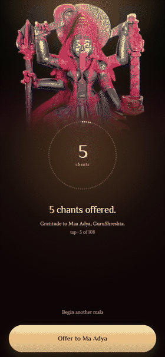

# MANTRINI · app

The Direction 02 ("The Lamp") rebuild of MANTRINI, as a single offline-first web
app that also ships as an Android APK.

- **Web**: Vite + Preact + TypeScript. ~57 kB JS / ~32 kB CSS before gzip.
- **Android**: Capacitor wraps the *same* build — no second codebase.
- **Storage**: IndexedDB on the device. No backend, no account, no telemetry.
- **Brand**: palette and type matched to `jaikhyapaparampara.com` — see below.

---

## Brand

The app belongs to the Jai Khyapa Parampara site, so it uses that site's own
tokens rather than a palette of its own.

**Palette** — copied verbatim from the `:root` block of
`jaikhyapaparampara.com/styles.css`, aliased in `src/styles/base.css`:

| Brand token | Value | Used for |
|---|---|---|
| `--dark-bg` | `#0D0506` | app ground, status bar, splash |
| `--light-bg` | `#1F0B11` | temple shadow |
| `--card-bg` | `#180A0F` | raised surfaces, sheets |
| `--primary-color` | `#8B2635` | deep temple maroon |
| `--secondary-color` | `#C9A962` | antique gold |
| `--accent-color` | `#E8C468` | the single accent ("where you are now") |
| `--accent-bright` | `#F4E4C1` | candlelight highlight |
| `--text-dark` | `#F0DCC8` | body text |
| `--text-light` | `#FFF8F0` | brightest text |

**Typography** — the same two faces the site sets: **Philosopher** for display
(headings, the wordmark, every numeral) and **Crimson Text** for body, plus
**Noto Sans Devanagari** for the mantras, exactly as the site does. All three are
OFL and self-hosted; `tools/fetch-fonts.mjs` downloads them and generates
`src/styles/fonts.css`. 236 KB of woff2 in total.

**How the swap was done.** The app had been built on a palette of the same
*family* — temple maroon and gold — but with brown-black grounds and an amber
accent. `tools/remap-brand-palette.py` rewrote every remaining literal in the
stylesheets onto the brand ramp in one deterministic pass, rather than
hand-editing dozens of rules and letting them drift. The script is kept as a
record of the mapping; it is a no-op today.

**Things that deliberately did not change.** The per-deity plate colours in
`src/data/deities.ts` are sampled from each photograph, not from the brand — they
exist so a photo fades into its own image. The darshan photographs and their
scrims kept their structure and only changed colour.

### The app mark

`tools/make-brand-icon.py` draws the icon rather than cropping a photograph: the
gold trikoṇa on the temple-maroon gradient, with the deity inside toned down
toward maroon so the installed app reads as a mark at 48 dp instead of a smeared
photo. One run produces every size the app needs:

- `public/icons/` — 512, 192, 180 (apple-touch), 32 (favicon), and a 512 maskable
  variant whose mark is pulled inside Android's 80 % safe zone
- `android/…/mipmap-*/` — legacy launcher, round launcher, and adaptive foreground
  (transparent, inside the 66 % safe zone, over `#1F0B11`)

Run it after changing any brand colour:

```bash
python tools/make-brand-icon.py
npm run cap:sync
```

### The offering



Tapping **Offer to Ma Adya** gives the mala away rather than just closing a
screen. `styles/offering.css` and `components/BlessingRing.tsx` between them:

1. light all 108 beads gold — it is no longer a partially-finished ring, it is
   the whole mala being given;
2. unthread them in order, each travelling to a point above the ring, so the
   circle funnels inward and upward into her image;
3. bloom a warm light where they converge, and let the count, the gratitude and
   the buttons thin away beneath it;
4. hold a veil that peaks exactly at the Blessing → Today swap, carrying the
   trikoṇa faintly, so the change of screen is an exhale and not a cut.

Each bead's travel is computed in `BlessingRing` (`--fx`, `--fy`, `--od`),
because CSS cannot know where a bead sits relative to the centre of its own
ring. Everything else is one class, `.is-offering`, on the Blessing screen.

**Timings live in two places and must be changed together:** the CSS keyframes in
`styles/offering.css`, and the `beginOffer()` constants in `state/store.ts`
(swap at 1250 ms, veil cleared at 1800 ms). Under `prefers-reduced-motion` the
beads do not fly, the veil is not rendered, and the store swaps almost
immediately.

`tools/capture-offer-frames.mjs` + `tools/make-offer-gif.py` reproduce
`docs/offering.gif`.


Two lines are not the app's own:

- The Blessing screen closes with **"Offer to Ma Adya"** — the sitting is given,
  not merely finished. Ma Adya is the receiver of every offering.
- The Ledger footer carries the Parampara's own closing words,
  **"Om Shri Gurubhyo Namaha | Jai Khyapa Parampara"** and
  **"May every Japa bring you closer to Ma Adya Mahakali."**, because the app is
  linked from that site and will read as part of it.

The same four words describe the four modes everywhere — **Tap · Audio · Timer ·
Auto** — so the vocabulary never shifts between the Altar tiles, the running
session and the Blessing.


---

## Audio

Four clips, one per deity, in `public/audio/`. `tools/reencode-audio.py` normalises
them to a single spec — **mono, 44.1 kHz, 96 kbps MP3, -16 LUFS** — because the
originals ranged from 65 kbps to 329 kbps with one stereo file among monos, which
made the bundle heavy and the loudness jump between deities.

| | before | after |
|---|---|---|
| audio payload | 285 KB | **111 KB** |

It reads the Flutter originals in `assets/audio/`, never the already-encoded
copies, so repeated runs cannot degrade the audio. It **aborts if a clip's
duration drifts by more than 60 ms**, because the counting cadence is derived
from clip length.

### Which mode uses it

| Mode | Behaviour |
|---|---|
| Tap | silent |
| Audio | plays once per count, triggered by the devotee |
| Timer | loops for the whole sitting |
| Auto | loops; the malas count themselves |

### The cadence, and what happens when audio fails

In the looping modes the count is derived: `floor(elapsed / clipLength)`. The
clip length **is** the cadence, so the four deities finish a mala at different
speeds — Batuk ~1m56s, Skanda ~3m29s, Adya ~4m28s, Swarna ~6m41s.

Starting a sitting writes to IndexedDB before any sound plays, so the real
`play()` lands several tasks after the tap. Browsers only grant playback
permission from *inside* the gesture, and Safari is strict about it — the chant
was silently refused there. `ChantAudio.prime()` is therefore called
synchronously at the top of `store.start()`: it starts the element muted and
pauses it, which stamps playback permission onto it for the rest of the sitting.
`tools/check-audio-gesture.mjs` installs a shim that applies Safari's rule
exactly, and fails if the fix is removed.

If the audio cannot start at all — blocked autoplay, decode failure, data saver —
the app falls back to the clip's known length, stored as `chantMs` on each deity
record, so an automatic sitting still counts and still completes. The failure is
announced once, honestly, and logged to the console for diagnosis.

Before that fallback existed the count silently stayed at zero and the session
could never finish, while the message claimed the count "still works".
`tools/check-audio-fallback.mjs` blocks every chant file and asserts that Auto,
Timer **and** Audio modes keep counting; `tools/check-audio-playback.mjs` asserts
the real clips decode and advance a count.

## Quick start

```bash
cd app
npm install
npm run dev          # http://localhost:5173
```

Then:

| Command | What it does |
|---|---|
| `npm run dev` | Dev server with HMR |
| `npm run check` | TypeScript, no emit |
| `npm test` | Unit tests (Vitest) |
| `npm run build` | Typecheck + production build into `dist/` |
| `npm run preview` | Serve `dist/` to check the real build |
| `npm run cap:sync` | Build, then copy `dist/` into the Android shell |

## Platform behaviour

The app runs in any modern browser, but three things are genuinely
platform-dependent. Two are handled; one cannot be.

| Behaviour | Android / desktop | iOS |
|---|---|---|
| Install | Install prompt from the browser | Share → Add to Home Screen (manual) |
| **Haptic tap feedback** | `navigator.vibrate` — works | **Not possible.** Safari has never shipped it |
| **Screen stays awake** | Screen Wake Lock API | Screen Wake Lock API (Safari 16.4+) |
| **Storage durability** | `persist()` usually granted | Evicted after 7 days *unless* added to Home Screen |

What the code does about it:

- `lib/wakelock.ts` — takes a screen wake lock for the duration of a session and
  re-takes it when the tab becomes visible again, so a 45-minute sitting is not
  interrupted by the screen sleeping and the chant stopping.
- `lib/storage.ts` — calls `navigator.storage.persist()` before the first write,
  and the ledger tells the truth when the browser declines.
- `components/InstallHint.tsx` — one dismissible line on iOS only, explaining
  Add to Home Screen. Without it, Safari may clear the ledger after a week.
- `lib/haptics.ts` — Capacitor bridge haptics inside the APK, `navigator.vibrate`
  in Android browsers, silent no-op elsewhere.

Verified by `tools/platform-check.mjs` (all six checks pass) — it asserts that
persist is requested, the wake lock is taken on start and released on pause, and
the install hint appears only on iOS and stays dismissed.

**The honest gap:** on iPhone, the counting haptic does not exist in any browser
and never will. Everything else about the app works there. If touch feedback
matters on iOS, that is the one reason to keep a native build.

## Offline

The app is offline-first. Everything it needs is precached on the first visit
(~827 KB), and after that it runs with the network completely cut.

`tools/check-offline.mjs` proves it rather than asserting it: it installs the
service worker, calls `context.setOffline(true)`, reloads, and then uses the app.
It first asserts that an external site is genuinely unreachable, so the test
cannot pass by accident. With no network at all, it verifies that the app

- boots from a cold reload (measured ~1.4 s),
- loads all three brand fonts **from cache** — otherwise the mantras render as
  empty boxes,
- serves the chant audio from cache, not the network,
- renders all four deity photographs,
- counts a session through to the Blessing,
- writes to IndexedDB, and still shows the work after another offline reload.

**What still needs a network:** the first visit, which is what installs the app.
Nothing else — including the install icons, which are fetched lazily and are
only needed when the browser shows its install prompt.

**The APK is offline by construction.** The same build is copied into the native
shell and served from disk, so there is no cache to miss. That path is still
unverified locally — this machine has no JDK or Android SDK.

**On iPhone**, Safari may evict a site's storage — cache included — after seven
days of no use *unless* the app has been added to the Home Screen. The app asks
for persistent storage on boot and shows a one-line Add to Home Screen hint when
it detects iOS in a browser tab. Haptics remain unavailable on iOS in any
browser.

## Verification

The repo ships three scripts that run against a **real browser** and are the
checks this project is held to:

```bash
npm run build
npm run preview -- --port 5200 &

APP_URL=http://127.0.0.1:5200/ node tools/capture.mjs              # all screens, screenshots to .shots/
APP_URL=http://127.0.0.1:5200/ node tools/a11y.mjs                 # contrast, type size, tap targets
APP_URL=http://127.0.0.1:5200/ node tools/platform-check.mjs       # wake lock, storage, iOS hint
APP_URL=http://127.0.0.1:5200/ node tools/check-audio-playback.mjs # clips decode and count
APP_URL=http://127.0.0.1:5200/ node tools/check-audio-fallback.mjs # counting survives no audio
APP_URL=http://127.0.0.1:5200/ node tools/check-audio-gesture.mjs  # sound starts inside the tap
APP_URL=http://127.0.0.1:5200/ node tools/check-offline.mjs        # network cut, app still works
npm test                                                          # domain logic
```

`tools/a11y.mjs` fails the run on any text below 4.5:1 contrast under 24 px, any
label under 12 px, any control under 44×44, or any runtime error. All six screen
states currently pass.

## Screens

| Screen | Purpose | Replaces |
|---|---|---|
| **Opening** | Brand, one-line positioning, and the dedication | the old 2.8 s unskippable splash |
| **Today** | Today's count, the last altar, and one way back in | the old welcome brochure |
| **Altar** | Four deity plates, four modes, mala target | "Choose Deity" grid |
| **Session** | The counting surface: darshan, 108-bead seam, count, one thumb pill | the old session form |
| **Blessing** | The mala closing | the completion `AlertDialog` |
| **Ledger** | Today, week, per-deity, recent sittings, backup | "Sadhana Tracker" |

### The opening screen

`components/Splash.tsx` carries the darshan, the brand line, and the dedication.

**The triangle.** The Adya Mahakali photograph sits inside a downward-pointing
trikoṇa — the Shakti triangle, central to Ma Kali's yantra and the form the
devotee asked for. It is drawn as **one** stroked triangle and nothing more. A
complete Kali yantra adds concentric circles, an eight- or sixteen-petal lotus,
and the bindu; reproducing those from memory would be decoration pretending to
be devotion, so the one unambiguous form is used and the rest is left out
deliberately. If the exact yantra matters, supply the plate you use and the SVG
is a one-file change.

It is also the real boot state — shown while IndexedDB opens, then for a 1.15 s
minimum so it registers as a brand screen rather than a flicker. It dismisses on
tap as soon as the app is ready and is hard-capped at 4 s. Audit defect B2 was
specifically that the old splash was 2.8 s and unskippable; this one is neither.

## Architecture

```
src/
  data/        types, deity content, IndexedDB, repository, backup, pure stats
  state/       session arithmetic (pure) and the single app store
  lib/         audio element wrapper, haptics, formatting
  components/  mala seam, blessing ring, nav pill, sheet, toast
  screens/     one file per screen
  styles/      tokens + shell, screens, generated @font-face
```

Two rules worth keeping:

1. **`data/stats.ts` and `state/session.ts` are pure.** All the counting and
   aggregation maths lives there, takes a clock as an argument, and is covered
   by tests. Nothing in them touches the DOM or IndexedDB.
2. **One store.** `state/store.ts` owns all mutable state and notifies
   subscribers; screens are pure functions of that state. The ticking clock only
   runs while a session is live.

### The 108-bead seam

`components/MalaSeam.tsx` places 108 beads along the curved lower edge of the
darshan photograph. The photograph is clipped to the same curve by an SVG
`clipPath` in `objectBoundingBox` units, so beads and edge stay aligned at any
screen height. If you change the curve, change both — the path is
`M 0 0 L 1 0 L 1 0.895551 Q 0.5 1.104449 0 0.895551 Z`.

## Data and backups

Sessions live in IndexedDB (`mantrini` database, `sessions` store).

The backup envelope is **byte-compatible with the old Flutter app**:

```json
{ "format": "sadhana_for_a_khyapa_backup", "version": 1,
  "exportedAt": "…", "sessions": [ { "deityId": "…", "mode": "manual", … } ] }
```

That means a devotee moving from the APK can open the old app → Ledger → Backup,
copy the JSON, and paste it into Ledger → Restore here. `test/backup.test.ts`
pins this contract with a payload copied from the Flutter repository.

On boot the app also **reaps orphaned sessions**: anything left `active` or
`paused` by a crash or a closed tab is folded into `cancelled`, so a killed
session can never sit in the database forever (audit defect B3).

## Android APK

The wrapper is Capacitor. The APK contains the web build on disk, so it runs
fully offline with no server.

```bash
npm run cap:sync                    # rebuild + copy into android/
cd android && ./gradlew assembleDebug
# app/build/outputs/apk/debug/app-debug.apk
```

You need JDK 21 and the Android SDK. **Neither is installed in this checkout's
development environment**, so the APK is built in CI (`.github/workflows/app-pwa.yml`),
which uploads `mantrini-apk-debug`. Nothing here was validated with a real
Gradle run locally — treat the first CI run as the proof.

### Release signing

Exactly like the Flutter app: `android/key.properties`, never committed.

```properties
storeFile=release.keystore
storePassword=…
keyAlias=…
keyPassword=…
```

Debug builds ignore it. `assembleRelease` **fails fast** if it is missing, rather
than quietly producing a debug-signed APK. For CI, set these repository secrets:

- `ANDROID_KEYSTORE_BASE64` — the keystore, base64 encoded
- `ANDROID_KEYSTORE_PASSWORD`
- `ANDROID_KEY_ALIAS`
- `ANDROID_KEY_PASSWORD`

Then run the *Build MANTRINI app* workflow with `deploy` checked to get a signed
`mantrini-apk-release` artifact.

### App identity

- Package: `org.mantrini.japa`
- Version: 2.0.0 (versionCode 2)
- Portrait only, dark theme, no white flash on launch
- `VIBRATE` permission for the counting haptics

> **Note on the package name.** The Flutter app's applicationId is different, so
> this APK installs *alongside* the old one rather than upgrading it. That is
> deliberate for the migration window: if the new build misbehaves, the devotee
> still has the old app and its data. Once you are happy, keep this package and
> retire the old one — do not rename it afterwards, or every install will look
> like a new app and lose its local history.

## Deployment (web)

`dist/` is a static site. It is built with `base: './'`, so it works from a
domain root **or** a subpath.

For the existing Cloudflare Pages project, the shape that matches
`docs/web-hosting.md` is landing at `/` and this app at `/app/`. Vite's relative
base already handles that; just upload `dist/` into `/app/`.

## Relationship to the Flutter app

`lib/`, `android/`, `ios/`, `web/`, `test/` and `pubspec.yaml` at the repository
root are the **original Flutter app and are untouched by this work.** It still
builds and its three tests still pass. Nothing here removes it.

The intended path is: ship the PWA and the new APK, let them prove themselves,
then retire the Flutter tree in a separate commit. Keeping both until then means
no devotee is ever left without a working app.
